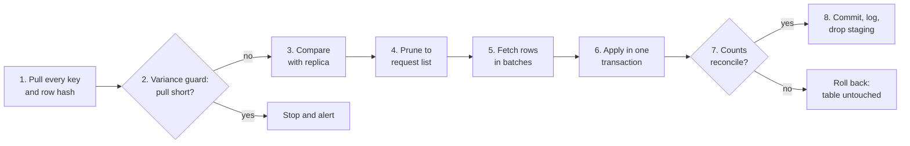

# erp-hashdiff-sync

As technical lead and data architect, reporting to the CTO, I designed and built, alone, the nightly replication of a vendor ERP: roughly 700 tables and 2 billion rows, reconciled every night in about 38 minutes. It replaced a 9-hour process that silently missed changes, duplicated rows, and kept deleted ones. It compares every row by key and hash, fetches only what changed, and detects deletes the ERP never records.

The ERP keeps no record of deletes (no tombstones), its modified dates can't be trusted, it declares none of its keys, and it sits behind a proprietary driver with a hard query timeout and a query-text limit. The client's code and data cannot be shared, so this repository rebuilds the problem from its constraints in T-SQL, over a real SQL Server linked server, reimplements the solution from scratch, and proves it against a generated stand-in ERP.

The method, step by step in the SQL it generates, is in the essay [Detecting Inserts, Updates, and Deletes Without Tombstones](essay/method.pdf) (PDF, 6 pages).

## Results

Measured on the stand-in: 120 tables, 1.2 million rows, the first load and 7 simulated nights. The old process reimplements the inherited SSIS packages' logic, including the bugs I found in production.

| | Old process | This process |
|---|---|---|
| Tables correct after 7 nights | 111 of 120 | **120 of 120, every night** ([proof](proofs/02-nightly-correctness.md)) |
| Discrepancies: rows missing, stale, or deleted but still present, and duplicated keys | 68,936, growing every night | **0** ([proof](proofs/03-old-versus-new.md)) |
| Errors raised about any of it | 0 | none needed: every table exact |
| Deletes detected, with no tombstones | none: reloaded tables drop them, and the incremental tables kept 268 | **507 of 507** over 7 nights |
| Rows fetched per night | about 560,000: most tables reloaded in full | about 1,900: only what changed, after comparing all 1.2M keys |
| A table that fails mid-run | not reproduced here | left untouched, caught up the next night ([proof](proofs/04-failure-and-recovery.md)) |

The old process failed silently. That is the problem this design solves: not speed, but a copy of the ERP that can be trusted without checking it.

## The problem

The ERP was reachable only through a SQL Server linked server, backed by the vendor's proprietary driver:

- **A 15-minute hard timeout** on every query, with no exceptions.
- **A limit on query-text length**, which capped how much could be said in one statement.
- **Read-only access.** Nothing could be created on the vendor's side: no staging tables, no temp tables, no views.
- **No tombstones.** A deleted row simply disappears.
- **Create and modify dates that cannot be trusted:** sometimes missing, sometimes not updated when a row changes.
- **Undeclared keys.** The catalog marks no primary keys. The real keys are composite (an int, usually codes, sometimes a date) and had to be read from the vendor's data dictionary.

The inherited process was two SSIS packages. One fully reloaded the tables small enough to reload: correct, but most of a 9-hour window. The other ran incremental upserts on the large tables, filtered by those unreliable dates and keyed on the wrong columns, because whoever built it had not understood the composite keys. The result was missed changes, collapsed and duplicated rows, and deletes that were never seen, with no errors anywhere.

## The design

One path for every table, every night, including the first load. One procedure, [`sync.usp_sync_table`](sql/warehouse/30_sync_process.sql#L230), runs once per table, many tables in parallel, started by a thin runner that stands in for the original SSIS package. Every statement it sends to the ERP is generated from two inputs: a copy of the ERP's column metadata, and the manifest, a hand-kept list of each table's key columns.



1. **Pull every key and a hash of its whole row, in one query.** The hash is computed on the ERP's side, so only keys and 32-character hashes cross the wire. At 500 million rows, this pull still finished inside the timeout. ([step 1](sql/warehouse/30_sync_process.sql#L392))
2. **Guard against a short pull (the variance guard).** If the pulled key count falls more than a small allowance below the replica's active rows, stop before comparing anything. ([step 2](sql/warehouse/30_sync_process.sql#L398))
3. **Compare against the replica.** New: the key is not in the replica. Changed: the hash differs, or a deleted key has come back. Deleted: active in the replica, missing from the pull. ([step 3](sql/warehouse/30_sync_process.sql#L409))
4. **Prune to a request list** of new and changed keys only.
5. **Send the keys back to the ERP inside the query text.** Nothing can be created on the vendor's side, so the only place to put a list of keys is the statement itself: a `VALUES` list of escaped literal tuples, joined on every key column. Batch sizes come from arithmetic on the statement. Its fixed text is mostly the select list; the keys' literals fill the rest of the text limit, up to 5,000 rows per batch. ([step 5](sql/warehouse/30_sync_process.sql#L434))
6. **Stage everything, then apply it in one transaction:** flag the deletes, remove the changed rows, insert the fetched ones. ([step 6](sql/warehouse/30_sync_process.sql#L503))
7. **Reconcile every count before committing.** The replica must end up holding exactly the keys that were pulled, or the transaction rolls back. ([step 7](sql/warehouse/30_sync_process.sql#L520))
8. **Log every count, then drop staging.** Each attempt at a table writes one log row: its counts, batches, retries, and timings, or the error that stopped it. The alert email is built from this log. Staging is dropped only after the log records success. Once the changes are committed, a logging or cleanup error is recorded, but the table is not marked failed. ([step 8](sql/warehouse/30_sync_process.sql#L531))

### Why each piece is there

- **One hash query, not a filtered pull.** The dates cannot be trusted, so nothing short of comparing every row finds every change, and comparing hashes makes that cheap. Pulling every key is also the only way to see a delete when the source leaves no trace of one.
- **Cast by type before hashing.** Default conversions round money to two decimals, float to six significant digits, and datetime to the minute. Each type gets an explicit style that keeps full precision: [`sync.fn_hash_piece`](sql/warehouse/30_sync_process.sql#L126).
- **NULL becomes a character real text values do not contain**, so NULL and an empty string hash differently.
- **`varchar(max)` from the first character.** Without it, SQL Server silently truncates the concatenation at 8,000 characters, or at 4,000 once an `nvarchar` column joins in, and changes past that point go unseen. I hit this bug in the original, and this rebuild hit it again independently.
- **The ERP's hash is stored on each replica row**, and the next night compares against it. The warehouse never reproduces the ERP's casting, so the two sides never hash the same row differently. (One narrow gap remains; see [What I would change](#what-i-would-change).)
- **Keys go back as literals because there is no other way in.** Every quote in a key code is doubled; one unescaped quote breaks the batch.
- **Delete then insert, rather than update.** Simpler dynamic SQL across hundreds of different table shapes, and a table's whole change lands at once.
- **Nothing is applied until everything is staged.** A table that fails is left exactly as it was, and the next run picks up what it missed. That includes a wipe and reload: the old rows are removed inside the same transaction that inserts the new ones. Attempts are nested: up to three per fetch batch inside the procedure, and up to three per table in the runner.
- **The variance guard** exists because a short pull looks exactly like mass deletion. Without it, a partial restore on the vendor's side would soft-delete thousands of rows.
- **One alert email per bad run.** The original SSIS package ran a Send Mail task on failure. Here the runner calls [`sync.usp_alert_run`](sql/warehouse/60_alerts.sql), which sends one email through Database Mail if any table did not end the run succeeded, and calls out a variance-guard stop separately, because that needs a person to look before the next run. A table that failed once and then succeeded is not an alert.
- **Keys come from a manifest**, not the catalog, because the catalog declares none. Replicating another table means adding one row to it.
- **A vendor schema change stops the table by name.** The ERP's column list is re-read at the start of every run and compared with the replica. A column added, dropped, or retyped fails that table with a message naming the column, and the fix is to rebuild: drop the replica table, and the next run reloads it. In the original, schema changes came only with vendor updates, and were handled the same way, by hand.
- **One sync of a table at a time.** Staging tables are per table, so each table's run takes a lock, and the runner never lists a table twice.

## Proofs

Every proof is generated by a script and committed. None is edited by hand.

| Proof | Shows |
|---|---|
| [00 Infrastructure](proofs/00-infrastructure.md) | The warehouse reaches the ERP only through a read-only linked server with a hard timeout. Also a finding: through Microsoft's provider, that timeout is silent inside a procedure. |
| [01 Stand-in ERP](proofs/01-stand-in-erp.md) | 120 tables and 1.2M rows with undeclared composite keys, over 100,000 keys containing quotes, untrustworthy dates, 14 data types, and tables over 300 columns wide. |
| [02 Nightly correctness](proofs/02-nightly-correctness.md) | The first load and 7 nights of inserts, updates, untraceable deletes, and re-created keys, with an independent audit after every run: 960 of 960 table audits clean. |
| [03 Old against new](proofs/03-old-versus-new.md) | The old SSIS-style process on the same nights: silent drift in every incremental table, growing every night. |
| [04 Failure and recovery](proofs/04-failure-and-recovery.md) | Injected timeouts, a table failing for a whole night, a short pull stopped by the guard, a full wipe and reload, and the alert emails those runs sent. |
| [05 Hashing edge cases](proofs/05-hashing-edge-cases.md) | Six one-row changes an obvious first-draft hash misses, all caught. |

**The audit is independent of the sync wherever it can be.** It reads the ERP through its own linked server, with no timeout and no text limit; takes its column list from the ERP's own catalog, not the sync's metadata copy; and fingerprints rows with SQL Server's JSON rendering and SHA-256 instead of the sync's cast-by-type MD5. A bug in the sync's hashing or a stale column list cannot hide from it. What it shares with the sync is the manifest's key columns, because the ERP declares no keys, and the function that types them: [`audit.usp_audit_table`](sql/warehouse/40_audit.sql).

## What is real and what is simulated

- **Real:** SQL Server 2022, a linked server, `EXEC ... AT`, a read-only login that rejects any DDL or write, and a query timeout enforced by the provider.
- **Simulated, and the only simulated limit: the text limit.** SQL Server does not cap statement length the way the vendor driver did, so the single door to the ERP, [`sync.erp_exec_at`](sql/warehouse/10_sync_objects.sql#L98), rejects statements over 32,767 characters. The original's exact limit is not recalled, but it was never tight: batches ran to 2,000 keys or more, and 32,767, a signed 16-bit length, gives batches that size here. The widest table's single hash statement needs about 12,800 characters.
- **Restored: the timeout error.** Microsoft's provider reports a timeout as an informational message and returns no rows, with no error to catch ([proof 00](proofs/00-infrastructure.md)). The vendor driver raised a hard error, so the wrapper does too, for any call that runs to the timeout and returns nothing.
- **Scaled down:** 1.2 million rows instead of 2 billion, and a 30-second timeout instead of 15 minutes. The slowest statement uses under half of the timeout ([proof 02](proofs/02-nightly-correctness.md)).
- **Replaced:** SSIS only started one procedure per table, retried failures, and sent the failure email. A shell script starts and retries here, and the email is T-SQL; all the work is in the T-SQL.
- **Caught, not delivered:** alert emails go out through real Database Mail to Mailpit, a local mail server that keeps every message and delivers none.
- **The stand-in ERP** is generated in T-SQL from a seed, in a database the warehouse cannot see, and simulates nightly business activity: inserts, updates, deletes, re-created keys, and updates that leave the modified date alone.

## What I would change

- **Close the gap between the pull and the fetch.** The hash stored on a row comes from the key-and-hash pull; the values come from the fetch that follows. If a row changes between the two and then changes back before the next night's pull, the stored hash matches the source again and the in-between values stay in the replica. In the original I never saw transactions land between 2 and 3 a.m., so it never mattered, but it is possible. Fetching each row's hash alongside its values, and refetching any whose hash moved, would close it.
- **Retry only what a retry can fix.** Every failure except the variance guard is retried, up to three attempts per fetch batch and three per table, including errors that can never succeed on retry, such as a statement over the text limit. That is how the original worked; retrying only timeouts and connection errors would fail faster and log less noise.
- **Handle schema changes in place.** A vendor change to a table's columns stops that table until it is rebuilt from scratch. Adding the column to the replica and refetching only that table would keep it running.
- **Encode lengths instead of delimiting.** The original put a single pipe between fields; this rebuild uses `$|$`, which a value would have to contain to cause a collision. Prefixing each value with its length removes the possibility entirely.
- **Keep history for re-created keys.** A key that is deleted and later re-created replaces its old row. That was right for this use, but a consumer that needs to see the deletion would want both versions kept.
- **Guard growth as well as shrinkage.** The variance guard catches a short pull. A sudden large growth is rarer, but worth a look before loading.
- **Learn the thresholds.** The batch row cap and the variance allowance are set by hand. Each table's history of pull sizes and batch timings could set them instead.

## About this rebuild

The original was written in T-SQL on SQL Server and orchestrated by SSIS; its code stayed with the client. This version was written from my account of that design, with Claude Code, and checked against the stand-in by the proofs above. One detail is reconstructed rather than recalled: the variance guard's implementation, from its behavior. The exact text limit is not recalled; the stand-in's is a stated choice.

## Run it

Requires Docker (Docker Desktop or OrbStack), bash, Python 3 (as `python3` or `python`), curl, and openssl. About three minutes to the first two proofs; the rest take about an hour and a half.

```sh
./scripts/up.sh                # start both SQL Server instances and Mailpit, and install all SQL objects
./scripts/build-erp.sh         # generate the stand-in ERP (seed 7, about a minute)
./scripts/prove-infra.sh       # proofs/00
./scripts/prove-erp.sh         # proofs/01
./scripts/sync.sh              # one sync of every manifest table
./scripts/prove-nightly.sh 7   # proofs/02 and 03: first load and 7 nights, new and old process (about an hour)
./scripts/prove-resilience.sh  # proofs/04 and 05: failures, recovery, edge cases (about 20 minutes)
docker compose down            # stop and remove everything
```

Alert emails land in Mailpit's inbox at http://127.0.0.1:18025.

## Layout

```
sql/erp/          the stand-in ERP: login, generator, nightly activity, test scenarios
sql/warehouse/    linked servers, the driver wrapper, the manifest, the sync, the audit, the old process, alerts
sql/proofs/       the queries that write the proofs
scripts/          start, build, run, and prove
proofs/           committed output
```
